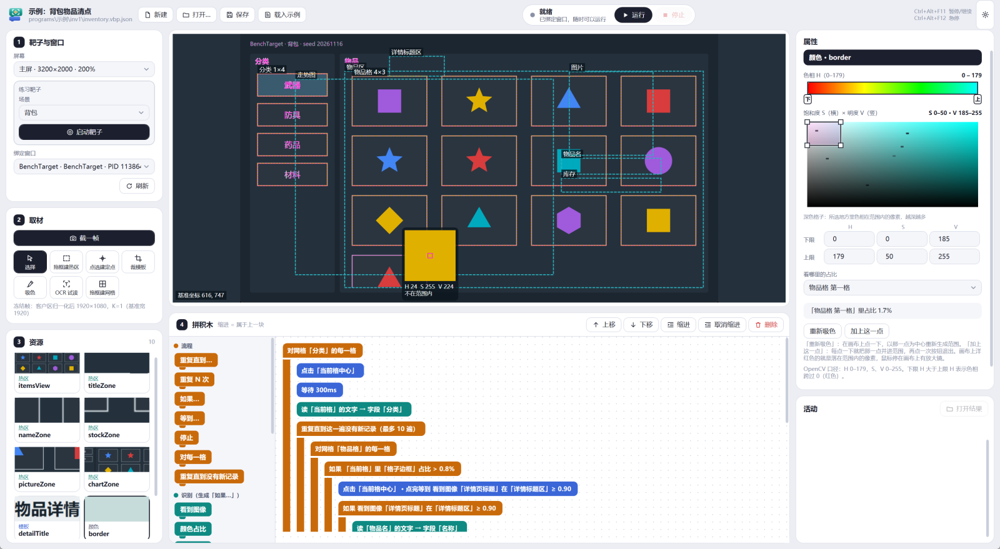

<p align="center">
  <picture>
    <source media="(prefers-color-scheme: dark)" srcset="docs/images/logo-dark.png">
    
  </picture>
</p>

<p align="center"><b>用拼积木的方式做「看屏幕 → 认出来 → 点一下 / 按个键 → 记下来」的 Windows 桌面自动化，不用写代码。</b><br>
Build “look at the screen → recognize → click or press → record” automation for Windows desktop apps by snapping blocks together. No code.</p>

<p align="center"><a href="#english">English</a> · <a href="docs/getting-started.zh.md">新手上手指南</a> · <a href="https://github.com/sailorsinbad14/visionblocks/releases">下载 / Download</a></p>



## 它能做什么

- **截一帧，在画面上框出来**：热区、模板（要认的小图）、颜色、网格（一格一格的列表）、定点，都在冻结的截图上拖框、点选建立。
- **拼积木写流程**：「对每一格」「重复直到没有新记录」「如果看到图像」「等到」「点击」「按键」「滚轮」「读文字」「截图存图」「记录一行」……橙色是流程，青色是识别和读取，蓝色是动作。
- **在截图上「试一下」**：每个条件、每次读字都能先在冻结帧上试，不用真跑。
- **结果是一张表 + 图片**：跑完得到 `data.csv`、`images\` 和一份 `manifest.json`，其他程序照着[结果格式说明](docs/results-format.zh.md)就能读。
- **安全**：只给你绑定的那一个窗口发键鼠，每次发之前检查它在前台；<kbd>Ctrl</kbd>+<kbd>Alt</kbd>+<kbd>F12</kbd> 随时急停，<kbd>Ctrl</kbd>+<kbd>Alt</kbd>+<kbd>F11</kbd> 暂停（默认的组合，设置里可以改）；屏幕顶上的状态胶囊和任务栏颜色一眼看出在跑、暂停还是被拦。
- **自带练习靶子**：巡逻小游戏和背包两个场景，配两个示例程序，在不碰任何真软件的情况下把整套流程跑一遍。
- 中文 / English 界面，浅色 / 深色主题，跟着每块屏幕的分辨率和缩放自适应。

## 下载

到 [Releases](https://github.com/sailorsinbad14/visionblocks/releases) 下载，两种任选：

| 文件 | 适合 | 数据放在哪 |
|---|---|---|
| `VisionBlocks-0.2.1-win-x64-portable.zip` | 解压就能用，整个文件夹拷走数据就带走 | 解压出来的文件夹里的 `data\` |
| `VisionBlocks-0.2.1-win-x64.exe` | 只要一个文件 | 程序和结果在「文档\VisionBlocks」，设置在 `%AppData%\VisionBlocks` |

都不用装 .NET。每个文件旁边有 `.sha256`，可以核对下载是否完整。

> **第一次运行会被 Windows 拦一下**：exe 没有代码签名，会弹「Windows 已保护你的电脑」，点「更多信息」→「仍要运行」。单个 exe 是自解压的，个别杀毒软件可能误报；介意的话用便携 zip，或者自己从源码编译。

**系统要求**：Windows 10 2004（19041）或更新、64 位。「读文字」用的是 Windows 自带的文字识别，要装「中文（简体）」语言（设置 → 时间和语言 → 语言和区域 → 添加语言）；没装时编辑器启动后会在「活动」里提醒。

## 怎么上手

看 **[新手上手指南](docs/getting-started.zh.md)**：先用练习靶子 5 分钟跑通示例，再从零拼一个「把背包里每个物品的名字、库存、图片记成表」的程序。

## 使用条款

视搭是一个通用的桌面自动化工具。请只把它用在：

- 你自己开发或拥有的软件；
- 你自己制作的离线单机游戏；
- 你被明确允许测试或自动化的程序。

**不要**把它用于他人的网络游戏、绕过反作弊或人机检测、违反其他软件用户协议的场景，也不要用来操作别人的账号。「鼠标操作随机化」（点击位置、时机和移动轨迹随机）只是为了测试**你自己的**软件或游戏能不能识别出自动操作，打开前编辑器也会提醒。

本软件按「现状」提供，不做任何担保，使用风险自负（见 [LICENSE](LICENSE)）。

## 从源码编译

需要 [.NET 10 SDK](https://dotnet.microsoft.com/download) 和 Windows 10 2004 以上。

```bat
dotnet build src\VisionBlocks.Studio -c Release
start-editor.cmd
```

- 自测（不发真实键鼠）：`dotnet build src\VisionBlocks.Runner -c Release`，然后运行 `vbrun selftest-recorder`、`selftest-humanize`、`selftest-guard`、`selftest-sizing`、`selftest-input`，以及 `vbrun selftest-editor programs\t1\snap-showcase.png <输出目录>`、`vbrun selftest-inventory programs\inv1\snap-grid.png programs\inv1\snap-detail.png <输出目录>`。
- 打两种发布包：`powershell -ExecutionPolicy Bypass -File tools\publish.ps1`，输出在 `out\package\`。

| 目录 | 内容 |
|---|---|
| `src\VisionBlocks.Studio` | 编辑器（WPF） |
| `src\VisionBlocks.Core` | 程序模型、运行器、截图、识别、输入 |
| `src\VisionBlocks.Overlay` | 运行时的遮罩和置顶状态胶囊 |
| `src\BenchTarget` | 练习靶子（打包在编辑器的同一个 exe 里） |
| `src\VisionBlocks.Runner` | 命令行工具 `vbrun`（自测、无界面运行） |
| `programs\t1`、`programs\inv1` | 两个示例程序和自测用的截图 |
| `docs\` | 新手指南、结果格式说明 |
| `tools\` | 打包、界面测试、结果核对脚本 |

## 许可证

[MIT](LICENSE)。第三方组件见 [THIRD-PARTY-NOTICES.md](THIRD-PARTY-NOTICES.md)。

---

<a id="english"></a>

## English

VisionBlocks (Chinese name 视搭) is a no-code automation editor for Windows desktop apps. You capture a frame, mark regions, templates, colors and grids on it, snap blocks into a program (“for each cell”, “if image is seen”, “click”, “press key”, “read text”, “record row”…), try each condition on the frozen frame, then run it. Results come out as `data.csv` plus images and a `manifest.json` that other programs can read ([results format](docs/results-format.en.md)).

- **Safe by design**: input goes only to the one window you bound, checked to be in front before every key or click. <kbd>Ctrl</kbd>+<kbd>Alt</kbd>+<kbd>F12</kbd> is an emergency stop, <kbd>Ctrl</kbd>+<kbd>Alt</kbd>+<kbd>F11</kbd> pauses (defaults; you can change them in Settings). A status pill at the top of the screen and the taskbar color show running / paused / blocked at a glance.
- **Built-in practice target** with two scenes and two sample programs, so you can try everything without touching real software.
- Chinese or English UI, light or dark theme, adapts to each monitor's resolution and scaling.

### Download

Get it from [Releases](https://github.com/sailorsinbad14/visionblocks/releases):

| File | When to use | Where data goes |
|---|---|---|
| `VisionBlocks-0.2.1-win-x64-portable.zip` | Unzip and run; copy the folder to take your data along | `data\` inside the folder |
| `VisionBlocks-0.2.1-win-x64.exe` | One file | Programs and results in Documents\VisionBlocks, settings in `%AppData%\VisionBlocks` |

No .NET install needed. Each file has a `.sha256` next to it.

> **Windows will warn on first run**: the exe is not code-signed, so SmartScreen shows “Windows protected your PC”; click “More info” → “Run anyway”. The single exe self-extracts, which a few antivirus products may flag; use the portable zip or build from source if that worries you.

**Requirements**: 64-bit Windows 10 2004 (19041) or later. “Read text” uses the OCR built into Windows and needs the Chinese (Simplified) language installed (Settings → Time & language → Language & region → Add a language); the editor tells you on start if it is missing.

### Getting started

See the **[getting started guide](docs/getting-started.en.md)**: run a sample against the practice target in five minutes, then build an inventory-recording program from scratch.

### Terms of use

VisionBlocks is a general desktop automation tool. Use it only on:

- software you develop or own;
- offline single-player games you made yourself;
- programs you are explicitly allowed to test or automate.

**Do not** use it on other people's online games, to get around anti-cheat or bot detection, in ways that break another program's terms of service, or to operate other people's accounts. “Randomize mouse actions” (random click positions, timing and movement paths) exists only to test whether **your own** software or game can tell automated input apart; the editor reminds you of this before turning it on.

The software is provided “as is”, without warranty of any kind; you use it at your own risk (see [LICENSE](LICENSE)).

### Build from source

Requires the [.NET 10 SDK](https://dotnet.microsoft.com/download) on Windows 10 2004 or later.

```bat
dotnet build src\VisionBlocks.Studio -c Release
start-editor.cmd
```

Self-tests (no real input is sent): build `src\VisionBlocks.Runner`, then run `vbrun selftest-recorder`, `selftest-humanize`, `selftest-guard`, `selftest-sizing`, `selftest-input`, `vbrun selftest-editor programs\t1\snap-showcase.png <outdir>` and `vbrun selftest-inventory programs\inv1\snap-grid.png programs\inv1\snap-detail.png <outdir>`. Release packages: `powershell -ExecutionPolicy Bypass -File tools\publish.ps1` (output in `out\package\`).

### License

[MIT](LICENSE). Third-party components are listed in [THIRD-PARTY-NOTICES.md](THIRD-PARTY-NOTICES.md).
