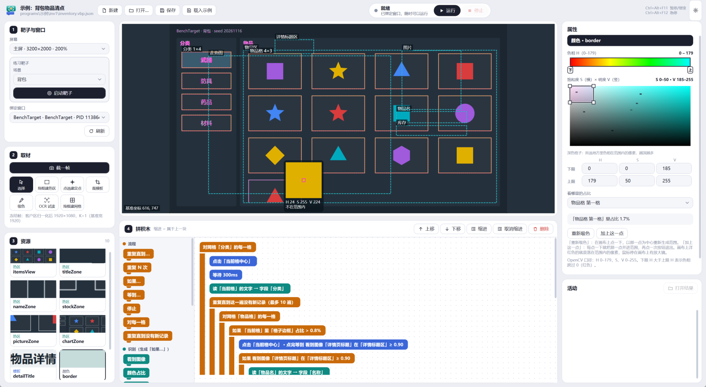
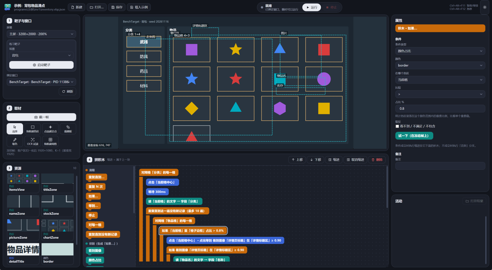

# VisionBlocks getting started

> 中文版：[getting-started.zh.md](getting-started.zh.md)

This guide has two parts: first **run a sample in five minutes** against the built-in practice target, then **build a program from scratch** that records every item in an inventory screen (name, stock, picture) into a table. You only ever operate the practice target, never real software. Please read the [terms of use](../README.md#terms-of-use) in the README first.

> The editor UI is in Chinese by default. Switch it in **⚙ Settings → Language → English**. Block summaries and a few help texts are still Chinese only; the names below give both.

## 1. Download and first start

1. Download from [Releases](https://github.com/sailorsinbad14/visionblocks/releases):
   - **Portable** `VisionBlocks-<version>-win-x64-portable.zip`: unzip somewhere writable (Desktop, drive D) and double-click `VisionBlocksStudio.exe`. Your programs, results and settings live in the `data\` folder next to it; copy the whole folder to take them along.
   - **Single exe** `VisionBlocks-<version>-win-x64.exe`: put it anywhere and run it. Programs and results go to Documents\VisionBlocks, settings to `%AppData%\VisionBlocks`.
2. On first run Windows shows “Windows protected your PC” (the exe is not code-signed): click “More info” → “Run anyway”.
3. Look at **Activity** (bottom right) after the editor opens: the first line says where your data is. If the Chinese (Simplified) language is missing it says so here; “Read text” needs it (Settings → Time & language → Language & region → Add a language → Chinese (Simplified)).

## 2. The editor at a glance



| Where | What |
|---|---|
| Top left | App icon, current program name and path; New, Open…, Save, Load sample |
| Top center | **Run capsule**: status + ▶ Run + ■ Stop; after a run, a small button opens the results |
| Top right | Hotkeys (by default <kbd>Ctrl</kbd>+<kbd>Alt</kbd>+<kbd>F11</kbd> pause / resume, <kbd>Ctrl</kbd>+<kbd>Alt</kbd>+<kbd>F12</kbd> emergency stop; follows Settings if you change them), ⚙ Settings |
| ① Target & window | Monitor, practice target (shown when enabled in Settings), **Bound window**, Refresh |
| ② Capture | **Capture frame**, plus 7 canvas tools: Select, Draw region, Place point, Crop template, Pick color, Try OCR, Draw grid |
| ③ Resources | Your regions, templates, colors and grids as cards with thumbnails, grouped by kind (click a group header to fold it); click a card to edit it on the right. The chips filter by kind and the Find box searches names and labels |
| Center top | Canvas: the frozen frame. Bottom left shows the mouse position in **base coordinates** (1920 wide, independent of window size and monitor) |
| ④ Build blocks | Block shelf on the left, the program on the right; title bar buttons: Copy, Paste, Up, Down, Indent, Outdent, Delete. Blocks in the program can be dragged to a new place (a line shows where it will land, a dashed frame shows the Repeat / If it goes into; hold Ctrl when releasing to drop a copy), and the right-click menu has Copy, Cut, Paste, Duplicate, Delete. Up / Down step into and out of Repeat / If blocks, like an IDE's move-statement. Undo / Redo in the top bar cover every change (up to 50 steps). The bar above the program shows which scope the selected block is in (“Drop into: …” while dragging), and its Repeat / If turns dark orange; when you scroll down, outer Repeat / If blocks that scrolled out stay pinned at the top, and clicking one jumps back to it. Every Repeat / If / For each cell block and every Else row has a small triangle that folds it to its header plus “… N blocks inside” (runs are unaffected); the right-click menu and <kbd>Ctrl</kbd>+<kbd>Shift</kbd>+<kbd>[</kbd> / <kbd>]</kbd> fold and unfold, <kbd>Ctrl</kbd>+<kbd>Alt</kbd>+<kbd>[</kbd> / <kbd>]</kbd> fold or unfold everything. Folding is saved in the program file |
| Right top | Properties of the selected block or resource; “Try it” tests a condition on the frozen frame |
| Right bottom | Activity: hints and run log. Each entry has a small chip in its block colour (flow orange, sensing teal, action blue, note yellow, error red) and says in one sentence what was clicked, read, recorded or skipped and why; “Open results” on its title bar. Drag the gap between Properties and Activity to resize them |

In a small window the editor switches to a compact layout where some buttons show only icons (hover for the name). Maximize the window while drawing regions; a larger canvas is more precise.

## 3. Run a sample in five minutes

1. Click **⚙** (top right), tick **Show practice target**, close Settings. ① now shows Scene and Launch target.
2. Click **Load sample**: it opens “示例：巡逻小游戏” (Sample: patrol game).
3. In ① set Scene to **Patrol game**, click **Launch target**. The target window opens and is bound automatically; it counts down “准备中 15…”.
4. Within 15 seconds click **▶ Run**, then keep your hands off the keyboard and mouse.
5. Watch: when an F keycap pops up the program presses F (E, R and the faded F are decoys), and when the health bar turns red it clicks “喝药” (drink potion). The run capsule and a small pill at the top of the screen are green, “Running”.
6. Press <kbd>Ctrl</kbd>+<kbd>Alt</kbd>+<kbd>F12</kbd> (the default e-stop) at any time to stop: the capsule shows “E-stopped” and all keys are released at once.

**Status colors**: green = running; amber = paused; red = input blocked (you clicked another window, so keys and clicks meant for the target were held back; click the target window to resume); after an emergency stop it is light red “E-stopped”, and the taskbar stays red until the next run.

## 4. Build a program from scratch: inventory recording

The goal: the practice target's **Inventory** scene has 4 categories on the left (武器 weapons, 防具 armor, 药品 potions, 材料 materials) and a grid of items on the right; clicking an item opens a detail page with its name, stock and picture. The program goes through each category and each cell, opens the item, records one table row, scrolls down, and moves to the next category at the end of the list. The finished version is the sample “示例：背包物品清点” (Sample: inventory recording); open it any time to compare (Open… → the samples folder → `inv1\inventory.vbp.json`).

All coordinates below are **base coordinates** (shown at the canvas's bottom left). They don't need to be exact.

### 4.1 Capture: the detail page

1. Click **New**. In ① set Scene to **Inventory** and click **Launch target**.
2. In the target window, **open the first item** (top-left cell, the purple square). When the detail page shows, go back to the editor and click ② **Capture frame**.
3. **Draw region** around the title 「物品详情」 with some margin (about 600,90 to 820,170), name it **详情标题区** (detail title area). *Create this region first*: new blocks default to the first region and template.
4. **Crop template** tightly around 「物品详情」 (about 634,104 to 766,150), name it **详情页标题** (detail title).
5. Three more regions: **物品名** (item name: the whole name row, about 1290,500, 400×64), **库存** (stock: the whole 「库存 23」 row, about 1290,580, 400×56), **图片** (picture: inside the white frame around the purple square, about 1322,152, 336×336).
   > Make text regions wide with blank space around the text. Windows OCR often misses text that touches the region's edge, and names vary in length.

### 4.2 Capture: the grid page

1. In the target, click × on the detail page (or press <kbd>Esc</kbd>) to go back to the grid, then **Capture frame** again.
2. **Draw region** around the whole item area (about 420,150 to 1860,1020), name it **物品区** (item area): the wheel scrolls at its center.
3. **Draw grid** along the border of the 「武器」 button (about 70,160, 280×90), name it **分类** (categories); in Properties set **columns 1, rows 4, column gap 0, row gap 30** (press Enter after each). The 4 boxes should fit the 4 buttons.
4. **Draw grid** along the first item cell (about 450,170, 300×200), name it **物品格** (item cells); set **columns 4, rows 3, column gap 60, row gap 40**. The 12 boxes should fit the first 3 rows.
5. **Pick color** on the white border of any cell, name it **格子边框** (cell border). Then click that color card in ③ and set the range in the **palette**: lower **0 / 0 / 185**, upper **179 / 50 / 255** (very bright, almost no color: only the white borders match). Pixels in range turn magenta on the canvas; when every cell border lights up, it is right.
   > Why not keep the picked range: the border is only 3 pixels wide and the picker samples a small patch around the click, so a click slightly off picks the background. In the palette you can drag the hue handles and the box in the S×V square while watching the magenta; “Add this point” merges the color you click on the canvas into the range.

### 4.3 Snap the blocks

There is one rule: **a new block goes after the selected block; if the selected block is a container (Repeat / If / For each cell, the orange C shapes), it goes inside it, at the end.** Each new block becomes selected, so you can mostly keep clicking.

Click these on the ④ shelf in order:

1. **For each cell** → **Click** → **Wait** → **Read text** → **Repeat until no new rows**
2. **For each cell** (lands inside “Repeat until…”) → **Color ratio** from the Detect group → **Click** → **Sees image** from the Detect group
3. **Read text** → **Read text** → **Save image** → **Record row** → **Key** → **Wait until**
4. In the program, click the **orange top bar** of “Repeat until no new rows” to select it, then click **Wheel** and **Wait**. They should sit at the same level as “For each cell (物品格)”, below it. If a block lands at the wrong level, select it and use Outdent / Indent / Up / Down in the title bar.

The finished structure:

```
For each cell of grid 分类
  Click center of current cell
  Wait
  Read text in current cell → field 分类
  Repeat until no new rows
    For each cell of grid 物品格
      If color 格子边框 in current cell > …
        Click center of current cell · then wait until image 详情页标题 is seen
        If image 详情页标题 is seen in 详情标题区
          Read text in 物品名 → field 名称
          Read text in 库存 → field 库存 (digits only)
          Save image 图片 → field 图片
          Record row (dedupe by 名称)
          Key Esc
          Wait until image 详情页标题 is not seen
    Wheel down 3 at 物品区
    Wait
```

### 4.4 Set the parameters

Select the blocks from top to bottom and change them in Properties (press Enter after numbers):

| Block | Set to |
|---|---|
| First Click | Click where = **region center: 当前格 (current cell)**; Confirm after = **No check** |
| First Wait | 300 |
| First Read text | Read where = **当前格**; Into field = **分类** |
| Inner For each cell | Grid = **物品格** |
| If … color ratio | In region = **当前格**; Ratio % = **0.8** |
| Inner Click | Click where = **region center: 当前格**; Confirm after = **Wait for condition**: Sees image 详情页标题 in 详情标题区, threshold 0.90; Confirm timeout 2000 |
| Second Read text | Read where = **物品名** (field 名称) |
| Third Read text | Read where = **库存**; field **库存**; tick **Digits only** |
| Save image | Capture where = **图片** |
| Record row | Dedupe by = **名称** (a new block picks the first field read above it at the same level, here 名称; with “No dedupe” every pass counts as new and only “Stop at list end” ends the loop) |
| Key | **Esc** |
| Wait until | tick **Negate** (becomes “not seen”); Max wait 2000 |
| Wheel | Scroll where = **region center: 物品区**; Notches **3** |
| Last Wait | 300 |

Click **Save** in the top bar.

### 4.5 Try it, then run

1. The canvas shows the grid page: select “If … 格子边框 …” and click **Try it (on the frozen frame)** in Properties. It should say the condition holds with a ratio of about 1.7%.
2. Click **▶ Run** and keep your hands off for about 40 seconds. The target opens and closes each item, scrolls down after each screen and switches category at the end.
3. When it finishes, click **Open results** on the Activity title bar: `data.csv` (opens in Excel) has 46 rows with columns 序号, 分类, 名称, 库存, 图片, and `images\` holds the item pictures.

A few names are misread and the 药品 rows have an empty category: that is a limit of the OCR built into Windows.

**If it goes wrong, check here first**

| What you see | Most likely |
|---|---|
| Ends after a few seconds without opening anything | The color range or Ratio % was not changed; “Try it” should hold |
| Opens details but records 0 rows | Wrong template or region in “If image is seen”; trying it on the detail-page frame should score close to 1 |
| Far more than 46 rows | Record row has no dedupe field 名称 |
| Scrolls after every cell | The Wheel landed inside “For each cell”; outdent it |
| Only weapons recorded | The first “For each cell” is not on grid 分类, or rows is not 4 |
| The pill at the top turns red, “Input blocked” | You clicked another window; click the target to resume, and rerun to cover the skipped steps |

## 5. Using it on your own software

1. Open your software (windowed) and pick it in ① **Bound window**. The first time you bind a program that is not on the program's allow-list, a dialog explains the risk; only “Yes” adds it.
2. While running, keys and clicks go only to that window (and dialogs it opens), and only when it is in front; otherwise input is blocked and the capsule turns red.
3. Coordinates are stored as 1920-wide base coordinates, so window size, monitor and scaling can change without editing the program, as long as the window keeps the same aspect ratio as when you captured.
4. If the capture is black, the software is probably in exclusive fullscreen; switch it to windowed or borderless.

### 5.1 Rows don't line up after scrolling: scroll by distance

How many pixels one wheel notch scrolls is up to the target program. On the practice target one notch is exactly one row; other software may differ, so 3 notches can be 2.5 rows and cells get cut off. Switch the Wheel block to scroll by distance:

1. Select the Wheel block and set **Scroll by** to **By distance px (measured)**. Scroll where must be a region, and the region should sit inside the scrolling content, without fixed headers, borders or scroll bars.
2. Enter the distance in **Distance px**, positive = down. It is in base coordinates (1920 wide, same as regions). To scroll whole rows, enter row pitch × rows; Properties shows the grid's row pitch and whether the rows will line up.
3. The frozen frame shows a preview: the orange arrow is the direction and distance the content moves, and the white dashed cells are where the cells will be after scrolling. If they sit on the grid, the rows line up.
4. While running, it measures how far the picture actually moved after every scroll and stops when it has scrolled enough. The overlay shows “target · scrolled · steps · px per notch” next to the arrow; in the run log it is the `wheelPx` line.

How exact it gets depends on the target program:

| Target program | Result |
|---|---|
| Accepts partial notches (the practice target does) | The last part is sent as a fraction of a notch. Measured on the practice target: off by less than 1 px |
| Whole notches only | Stops at the nearest whole notch, up to half a notch off; `subNotch` is false in the log. Rows may still not line up |
| End of the list | Stops when the picture stops moving; the log says `end`. The last page still overlaps the one before, so keep deduplication on |
| Can't measure (the region is blank, or all cells look the same and the shift is ambiguous) | Stops after at most one scroll; the log says `cantMeasure` |

Which kind your software is, you can only tell by running it once and reading the log. Scrolling by distance waits for the picture to settle after each step, so it is a little slower than notches (about 0.2–0.5 s per step). If one notch moves more than a little over half the region's height, it can't keep track (about 500 px for an 870-tall region), so make the region as tall as you can.

When several Wheel blocks scroll the same region in a row, whatever the previous one fell short by is added to the next (`carryIn`, `carryOut` in the log), so whole-notch programs don't drift further with every block. It resets at the end of the list, or when a block can't measure or is blocked.

### 5.2 The wheel won't stop where you want: use Drag

Some lists can be dragged with the mouse held down, which stops more precisely than the wheel. The **Drag** block under Actions presses inside a region, drags and releases, measures how far the picture moved, and adds another stroke if it is short.

1. **Drag in region**: as with distance scrolling, the region should sit inside the moving content.
2. **Distance px**: positive = page down (content moves up, the mouse drags up), the same direction as the wheel, in base coordinates. Properties shows whether it lines up with the grid's row pitch; the frozen frame shows the first stroke and where the cells end up.
3. **Speed** (800 px/s by default) and **Pause before release** (150 ms by default): some lists keep sliding after release at the speed you were dragging (common in Unity games, where holding still only slowly brings that speed down). After every stroke the block checks whether the list is still sliding; if it is, the pause for that region is doubled, up to 2 s, the sliding stroke is not used to learn the ratio and threshold, and the run messages say how long the pause became (`hold` and `slide` in the log). Only forward sliding counts: a list that springs back after you drag past its end, or settles back onto a row, isn't affected by how long you hold, so that isn't treated as sliding. To skip those first probing strokes, set the pause to about 600 ms yourself. If a fast drag is taken as a flick, slow it down.
4. One stroke is at most about 45% of the region's height; longer distances take several strokes. The first stroke measures how far the picture moves per dragged pixel (1 for dragging the list itself, more for a scroll bar) and how far the mouse must move before dragging starts; the same region reuses both. When what is left is too short to get past that threshold, one press first drags a little the other way and then back. The log has `dragPx` (per block) and `dragStroke` (per stroke).
5. Safety: every step while the button is held checks the foreground window and e-stop. Blocked, paused, e-stopped, or you moved the mouse (more than 3 px from where it was sent): the button is released at once. A drag paused halfway is measured again and continued after you resume.

Drag also carries the previous block's shortfall to the next one on the same region. The practice target's inventory can now be dragged: dragging starts after the mouse moves 10 px vertically, and an item opens only on a release without dragging. Launch options `--drag-threshold` (0 turns dragging off), `--drag-ratio` (list pixels per dragged pixel) and `--drag-inertia` (keeps sliding after release) imitate different programs.

### 5.3 Same-name items that differ only by a corner badge: Match pattern

Some items share a name and differ only by a badge on a corner of their picture (say an expiry of 1天 or 3天) and should be two rows. Deduping by name alone skips the second one as a duplicate. Putting a Save image field in the dedupe list does not work either, because it holds a file name that differs on every row (this is now rejected before the run). Instead:

1. Capture a frame showing an item with the 1天 badge and use **Crop template** in ② to crop the badge **tightly** (the badge only, not the item art behind it); name it 1天. Do the same for 3天 and every other badge.
2. Draw a region around that corner of the picture, a little larger than the badge. If the badge sits on the grid icon, use 当前格 (current cell).
3. Add **Match pattern** from the shelf: region = that corner, tick the badge templates, field = 有效期. It tries every ticked template, **keeps the highest score** and writes that template's name into the field, or the value for “none match” (「无」 by default) when even the best score is under the threshold (0.85 by default). Use “Try it” on frozen frames of each badge to see the scores.
4. Add 有效期 as a second dedupe field in Record row: a row is a duplicate only when both match. The result table also gains an 有效期 column.

Why not a chain of “If image seen”: two badge templates that differ by one digit score about 0.86 on each other's badge (measured on the practice target), above the threshold, so whichever is checked first wins. When scores are close, Match pattern also compares mean colour (same text, different background); if it still cannot tell, it writes the top one and flags it in Activity. Near misses below the threshold are flagged too, usually a badge you have not cropped yet.

When a name reads blank (most often a box too tight around the text), Read text retries once at 4x with padding. If it is still blank, Record row identifies the item by the other fields (badge included) and the saved picture.

### 5.4 Drags that stop short at the end: the grid follows

Real lists rarely end on a whole row: you ask for 720 px and the last drag moves only 330. The grid used to stay put and its cells straddled two rows. Now Drag and distance-mode Wheel record the shortfall, and the next For each cell shifts the grid that overlaps that region most by the shortfall modulo the row pitch, skips half-visible rows (already read on the previous page) and reads the newly revealed ones. The shift resets when Repeat until no new rows starts (a new category starts at the top). A block whose movement could not be measured does not shift and says so; notch-mode Wheel cannot measure and is not covered.

Repeat until no new rows has **Stop at list end** ticked by default: when a Drag or distance Wheel in a pass reports the end without moving at all, the loop stops after that pass. That saves one all-duplicate pass and ends the loop even with dedupe off. A drag that moved partway before hitting the end does not count, because the next pass still has to read the revealed rows.

The practice target's `--natural-end` makes lists end off-row like this, and `--twins` adds same-name items that differ only by a badge. Sample programs are in `programs\inv-twins`.

### 5.5 When one condition is not enough: and / or

Set the condition type of If, Wait until, Repeat until or a click's confirmation to **Several conditions**: choose “All must hold (and)” or “Any may hold (or)” and add ordinary conditions, each of which can be negated; the whole can be negated too. They are checked top to bottom and checking stops as soon as the result is known, so put slow text conditions last. There is one level only; nest If blocks for anything deeper.

## 6. Settings

| Setting | What it does |
|---|---|
| Language | 中文 (default) / English, applies right away |
| Theme | Use system setting (default) / Light / Dark, applies right away |
| Show practice target | Shows Scene and Launch target in ①; off by default |
| Pin outer scopes while scrolling | On by default. When the program scrolls down, Repeat / If blocks that scrolled out stay pinned at the top; beyond 5 levels the outer ones shrink into a one-line path, and clicking a part jumps there. They cover the top few rows; turn it off if that gets in the way |
| Shortcuts | ⚙ Settings → Shortcuts…: one row per action; click a box and press the new combination, conflicts ask before replacing, Reset all restores the defaults. Common defaults: <kbd>Ctrl</kbd>+<kbd>S</kbd> save, <kbd>Ctrl</kbd>+<kbd>Z</kbd> / <kbd>Y</kbd> undo / redo, <kbd>F5</kbd> run, <kbd>F6</kbd> capture frame, <kbd>1</kbd>–<kbd>7</kbd> canvas tools, <kbd>Ctrl</kbd>+<kbd>C</kbd> / <kbd>X</kbd> / <kbd>V</kbd> / <kbd>D</kbd> copy / cut / paste / duplicate, <kbd>Delete</kbd> delete, <kbd>Alt</kbd>+arrows up / down / indent / outdent; each shelf block has no key by default but can get one. Editing shortcuts work only in the editor window, and while you type in a box, Copy, Paste, Delete and the like stay with the box. Pause and e-stop are global hotkeys while running: they need <kbd>Ctrl</kbd> or <kbd>Alt</kbd> (simulated keys also trigger global hotkeys), e-stop can't be cleared, and changes apply from the next run |
| Randomize mouse actions | Off by default; asks before turning on. Clicks land at random spots inside the region with random hold and wait times; optional “Movement path” (curved, fast then slow) and “Overshoot”. **Only for testing whether your own software or game can tell automated input apart.** Each run's random seed is written to the run log (`bot.jsonl`). Movement time is not taken out of a Wait: a Click block first waits 30–120 ms, then moves, then presses, and a Wait block covers only its own span (×0.8–1.2 with “Position and timing” on); each wait's actual length is logged as a `wait` event |



## 7. Using the results in other programs

Each run's results folder holds `data.csv`, `images\` and `manifest.json`, and `results\latest.json` always points to the most recent one. See the [results format](results-format.en.md) for how to read them (with Python and C# examples).

## 8. FAQ

- **“Read text” is always empty**: make sure Chinese (Simplified) is installed, widen the text region with blank space around it, and test with “Try OCR” in ② or “Try reading” in Properties.
- **The pill stays red, “Input blocked”**: the target window is not in front. Don't touch the keyboard and mouse while running; pop-ups and notifications that take focus cause it too.
- **Cells are cut off after scrolling, rows don't line up**: one notch in this software is not a whole row. Switch the Wheel block to scroll by distance, see [5.1](#51-rows-dont-line-up-after-scrolling-scroll-by-distance). If only the last page is off, the grid now follows by itself, see 5.4.
- **Same-name items end up as one row**: they differ only by a badge on the picture. Turn the badge into a field with Match pattern and dedupe by it too, see 5.3.
- **Activity says Match pattern could not tell**: usually a badge you have not cropped yet, so crop it and tick it; or the template was cropped loosely and includes the item art behind it.
- **Hotkeys don't respond**: another program holds the pause or e-stop combination (by default <kbd>Ctrl</kbd>+<kbd>Alt</kbd>+<kbd>F11</kbd> / <kbd>F12</kbd>); Activity says so. Use ■ Stop in the run capsule, or pick another combination under ⚙ Settings → Shortcuts….
- **Portable build says the folder is not writable and data moved to Documents**: move the whole folder somewhere writable, such as the Desktop or drive D.
- **The taskbar still shows an old icon**: Windows' icon cache; unpin and pin again.
