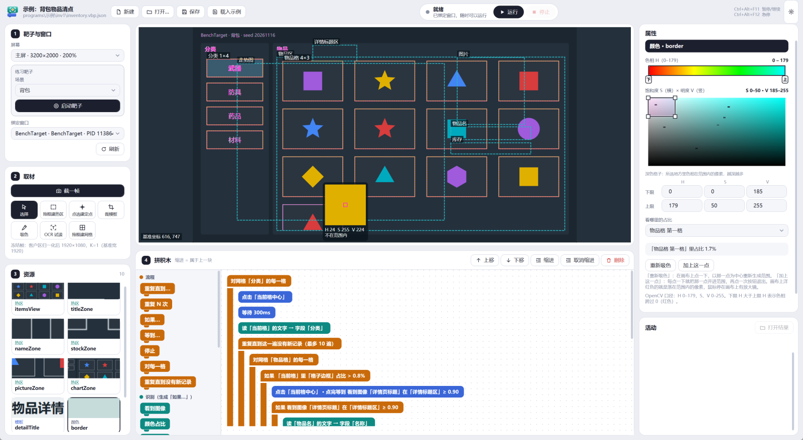
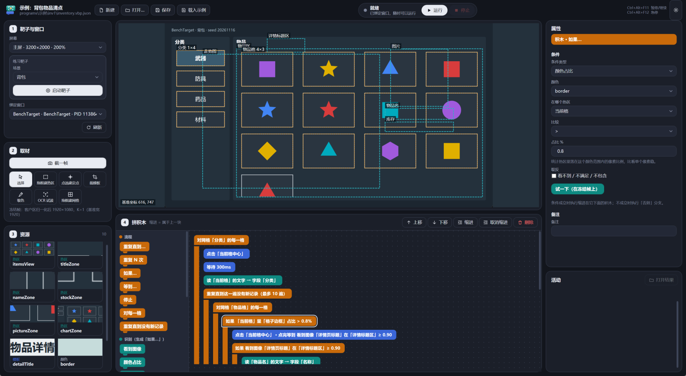

# 视搭 VisionBlocks 新手上手指南

> English version: [getting-started.en.md](getting-started.en.md)

这份指南分两步：先用自带的练习靶子 **5 分钟跑通一个示例**，再**从零拼一个程序**：把一个背包界面里每个物品的名字、库存和图片记成一张表。全程只操作练习靶子，不碰任何真软件。用之前请先看一眼 README 里的[使用条款](../README.md#使用条款)。

## 1. 下载、第一次打开

1. 到 [Releases](https://github.com/sailorsinbad14/visionblocks/releases) 下载：
   - **便携版** `VisionBlocks-<版本>-win-x64-portable.zip`：解压到桌面或 D 盘这类能写的地方，双击里面的 `VisionBlocksStudio.exe`。你的程序、结果、设置都放在旁边的 `data\` 里，整个文件夹拷走就带走。
   - **单个 exe** `VisionBlocks-<版本>-win-x64.exe`：放哪都行，双击运行。程序和结果放在「文档\VisionBlocks」，设置放在 `%AppData%\VisionBlocks`。
2. 第一次运行 Windows 会弹「Windows 已保护你的电脑」（exe 没有代码签名）：点「更多信息」→「仍要运行」。
3. 编辑器打开后看右下角的「活动」：第一行写着数据放在哪；没装中文（简体）语言时这里会提醒，「读文字」要靠它（设置 → 时间和语言 → 语言和区域 → 添加语言 → 中文（简体））。

## 2. 认识界面



| 位置 | 是什么 |
|---|---|
| 顶栏左边 | 应用图标、当前程序名和路径；新建、打开…、保存、载入示例 |
| 顶栏中间 | **运行胶囊**：状态 + ▶ 运行 + ■ 停止；跑完后多一个打开结果的小按钮 |
| 顶栏右边 | 热键提示（<kbd>Ctrl</kbd>+<kbd>Alt</kbd>+<kbd>F11</kbd> 暂停 / 继续，<kbd>Ctrl</kbd>+<kbd>Alt</kbd>+<kbd>F12</kbd> 急停）、⚙ 设置 |
| ① 靶子与窗口 | 屏幕、练习靶子（设置里打开才显示）、**绑定窗口**、刷新 |
| ② 取材 | **截一帧**，以及 7 个画布工具：选择、拖框建热区、点选建定点、裁模板、吸色、OCR 试读、拖框建网格 |
| ③ 资源 | 建好的热区、模板、颜色、网格，每张卡片带缩略图，点一下在右边编辑 |
| 中间上 | 画布：冻结的那一帧；左下角显示鼠标的**基准坐标**（按 1920 宽计，换窗口大小、换屏都不变） |
| ④ 拼积木 | 左边积木架，右边是程序；标题栏右边：上移、下移、缩进、取消缩进、删除 |
| 右上 | 属性：选中积木或资源后在这里改，「试一下」在冻结帧上试条件 |
| 右下 | 活动：提示和运行日志；标题右边「打开结果」 |

窗口比较小的时候会切成紧凑档，按钮只留图标，鼠标停上去能看到名字。拖框建资源时建议把窗口最大化，画布越大越准。

## 3. 5 分钟跑通示例

1. 点右上角 **⚙**，勾上 **显示练习靶子**，关掉设置。① 里出现「场景」和「启动靶子」。
2. 点顶栏 **载入示例**：打开的是「示例：巡逻小游戏」。
3. ①「场景」选 **巡逻小游戏**，点 **启动靶子**。靶子窗口打开并自动绑定，状态写着「准备中 15…」。
4. 15 秒内点顶栏的 **▶ 运行**，然后手离开键鼠。
5. 看效果：靶子里弹出 F 键帽时自动按 F（E、R、半透明的 F 是干扰项，不按），血条变红时点「喝药」。运行胶囊和屏幕顶上的小胶囊都是绿色「运行中」。
6. 随时按 <kbd>Ctrl</kbd>+<kbd>Alt</kbd>+<kbd>F12</kbd> 急停：胶囊变成「已急停」，所有按键立刻抬起。

**状态胶囊的颜色**：绿色 = 运行中；黄色 = 已暂停；红色 = 输入被拦截（你点了别的窗口，发给目标的键鼠被拦下了，点回目标窗口就恢复）；急停后是浅红「已急停」，任务栏上的红色保留到下次运行。

## 4. 从零拼一个程序：背包物品清点

目标：练习靶子的「背包」场景左边有 4 个分类（武器、防具、药品、材料），右边是物品格子，点开一个物品会出详情页（名字、库存、图片）。程序要逐个分类、逐格点开，把每个物品记成表的一行，翻到底就换下一个分类。做好的成品就是「示例：背包物品清点」，随时可以打开对照（「打开…」→ 示例文件夹 → `inv1\inventory.vbp.json`）。

下面的坐标都是**基准坐标**，拖框时看画布左下角，不用很精确。

### 4.1 取材：详情页

1. 点 **新建**，名字随意。①「场景」选 **背包**，点 **启动靶子**。
2. 在靶子窗口里**点开第一个物品**（第一行最左边紫色方块那格），等详情页出来；回到编辑器点 ② **截一帧**。
3. **拖框建热区**，框住「物品详情」四个字（留些空白，约 600,90 到 820,170），名字 **详情标题区**。*第一个热区一定先建它*：新积木默认用排第一的热区和模板。
4. **裁模板**，紧贴「物品详情」四个字（约 634,104 到 766,150），名字 **详情页标题**。
5. 再建三个热区：**物品名**（名字那一整行，约 1290,500 宽 400 高 64）、**库存**（「库存 23」那一整行，约 1290,580 宽 400 高 56）、**图片**（紫色方块白框里面，约 1322,152 宽 336 高 336）。
   > 文字框要宽、四周留白：Windows 的文字识别贴着字框容易读空、读错，名字长短也不一样。

### 4.2 取材：网格页

1. 在靶子里点详情页右上角的 ×（或按 <kbd>Esc</kbd>）回到网格页，编辑器里再 **截一帧**。
2. **拖框建热区**，框住右边整片物品区（约 420,150 到 1860,1020），名字 **物品区**：滚轮会滚在它中间。
3. **拖框建网格**，沿「武器」按钮的边框拖（约 70,160 宽 280 高 90），名字 **分类**；右边属性卡改 **列数 1、行数 4、列间距 0、行间距 30**（改完按回车）。画布上 4 个框应正好套住 4 个按钮。
4. 再 **拖框建网格**，沿第一个物品方框拖（约 450,170 宽 300 高 200），名字 **物品格**；改 **列数 4、行数 3、列间距 60、行间距 40**。12 个框套住前 3 行。
5. **吸色**，点在任意方框的白色边线上，名字 **格子边框**。然后在 ③ 点这张颜色卡片，用**调色盘**调范围：直接把数字改成 下限 **0 / 0 / 185**、上限 **179 / 50 / 255**（很亮、几乎没颜色，只有白边线符合）。画布上落在范围内的像素会标成洋红色，边线一圈都亮起来就对了。
   > 为什么不直接用吸色的结果：边线只有 3 像素宽，吸色在点击处周围取一小片，点偏一点就取成了背景色。调色盘上可以拖色相条的把手和 S×V 方块里的框，边拖边看洋红范围；「加上这一点」可以把画布上点到的颜色并进范围。

### 4.3 拼积木

规则只有一条：**新积木放在选中积木的后面；选中的是「重复 / 如果 / 对每一格」这类容器（橙色 C 形）时，放进它的口里、排在最后。** 点完一块，新积木会被自动选中，所以大多一路点下去。

在 ④ 积木架依次点：

1. **对每一格** → **点击** → **等待** → **读文字** → **重复直到没有新记录**
2. **对每一格**（进到「重复直到…」里）→ 识别组的 **颜色占比** → **点击** → 识别组的 **看到图像**
3. **读文字** → **读文字** → **截图存图** → **记录一行** → **按键** → **等到**
4. 在程序区点「重复直到这一遍没有新记录」那块的**橙色顶条**选中它，再点 **滚轮**、**等待**：它们应该和「对每一格（物品格）」同一层、排在它下面。放错层就选中它，用标题栏的「取消缩进 / 缩进 / 上移 / 下移」调。

拼好后的层次：

```
对网格「分类」的每一格
  点击「当前格中心」
  等待
  读「当前格」的文字 → 字段「分类」
  重复直到这一遍没有新记录
    对网格「物品格」的每一格
      如果「当前格」里「格子边框」占比 > …
        点击「当前格中心」· 点完等到 看到图像「详情页标题」…
        如果 看到图像「详情页标题」在「详情标题区」…
          读「物品名」的文字 → 字段「名称」
          读「库存」的文字 → 字段「库存」（只要数字）
          截「图片」存图 → 字段「图片」
          记录一行（按「名称」去重）
          按键 Esc
          等到 看不到图像「详情页标题」…
    在「物品区」滚轮向下 3 格
    等待
```

### 4.4 改参数

从上往下选中积木，在右边属性卡里改（数字改完按回车）：

| 积木 | 改成 |
|---|---|
| 第一块「点击」 | 点哪里 = **热区中心：当前格**；点完确认 = **不确认** |
| 第一块「等待」 | 300 |
| 第一块「读文字」 | 读哪里 = **当前格**；存进字段 = **分类** |
| 里面的「对每一格」 | 网格 = **物品格** |
| 「如果 …颜色占比」 | 在哪个热区 = **当前格**；占比 % = **0.8** |
| 里面的「点击」 | 点哪里 = **热区中心：当前格**；点完确认 = **等到条件成立**，条件 = 看到图像「详情页标题」在「详情标题区」，阈值 0.90；确认最多等 2000 |
| 「读文字」（第二块） | 读哪里 = **物品名**（字段「名称」） |
| 「读文字」（第三块） | 读哪里 = **库存**；字段 = **库存**；勾 **只要数字** |
| 「截图存图」 | 截哪里 = **图片** |
| 「记录一行」 | 按哪些字段去重 = **名称**（不填的话每一遍都算新记录，循环停不下来） |
| 「按键」 | **Esc** |
| 「等到」 | 勾 **取反**（变成「看不到」）；最多等 2000 |
| 「滚轮」 | 在哪里滚 = **热区中心：物品区**；格数 = **3** |
| 最后的「等待」 | 300 |

改完点顶栏 **保存**。

### 4.5 试一下，然后真跑

1. 画布上现在是网格页：选中「如果 …格子边框…」，点属性卡里的 **试一下（在冻结帧上）**，应该显示「成立：占比 1.7%」左右。
2. 点 **▶ 运行**，手离开键鼠，大约 40 秒。靶子会依次点开每个物品又关上，一屏看完往下滚，翻到底再换分类。
3. 跑完点「活动」标题右边的 **打开结果**：`data.csv`（Excel 能直接打开）有 46 行，列是 序号、分类、名称、库存、图片，`images\` 里是物品大图。

有几个名字读错、「药品」那几行分类为空，是 Windows 自带文字识别的局限。

**跑不对先查这里**

| 现象 | 多半是 |
|---|---|
| 几秒就结束，一个都没点开 | 颜色范围或占比 % 没改，「试一下」应该成立 |
| 点开了详情，但记录 0 行 | 「如果 看到图像」的模板或热区不对；在详情页那一帧上试一下应接近 1 |
| 记录远多于 46 行 | 「记录一行」没填去重字段「名称」 |
| 每格点完都滚一下 | 「滚轮」跑进了「对每一格」里，取消缩进 |
| 只记了武器就结束 | 第一块「对每一格」的网格不是「分类」，或行数不是 4 |
| 屏幕顶上胶囊变红「输入被拦截」 | 你点了别的窗口：点回靶子就恢复；漏掉的那几步建议停下重跑 |

## 5. 用在你自己的软件上

1. 打开你的软件（窗口化），在 ①「绑定窗口」下拉框里选它。第一次绑定不在白名单里的程序时，会弹确认框说明风险，点「是」才会加进这个程序的白名单。
2. 运行时只往这个窗口（和它弹出的对话框）发键鼠，每次发之前都检查它在前台；它不在前台时输入会被拦下，胶囊变红。
3. 坐标都是按 1920 宽的「基准坐标」记的：窗口换大小、换屏、换缩放，程序不用改，但窗口的长宽比要和截帧时一样。
4. 画面全黑：软件可能是独占全屏，改成窗口化或无边框再截。

### 5.1 滚完行对不齐：改成「按距离滚」

滚轮一格滚多少像素由目标程序自己决定。练习靶子一格正好一行，别的软件不一定：滚 3 格可能是 2.5 行，格子被切掉一截。这时把「滚轮」改成按距离滚：

1. 选中「滚轮」，**按什么滚** 选 **按距离 px（边滚边量）**。在哪里滚要选热区，热区要框在会滚动的内容里面，别框进不动的标题、边框和滚动条。
2. **距离 px** 填要滚的距离，正数向下。按基准坐标算（1920 宽，和热区一样）。要滚整行就填「行距 × 行数」，属性卡会写出网格的行距，以及滚完对不对得齐。
3. 截图上会画出预览：橙色箭头是内容移动的方向和距离，白色虚线格子是推算出来的滚完以后格子的位置，和网格重合就是对齐了。
4. 运行时每滚一下就量一次画面实际移动了多少，滚够就停。遮罩上箭头旁边写着「目标 · 已滚 · 步数 · 每格多少 px」，运行日志里是 `wheelPx` 这一行。

能准到什么程度取决于目标程序：

| 目标程序 | 结果 |
|---|---|
| 认「不足一格」的滚动（练习靶子就是这种） | 最后不足一格时发小数格补齐。练习靶子上实测误差不到 1 px |
| 只认整格 | 停在最近的整格，最多差半格，日志里 `subNotch` 是 false。这时行仍可能对不齐 |
| 列表到底了 | 画面不再动就停，日志写 `end`。最后一页还是会和上一页重叠，去重照样要设 |
| 量不出（热区里一片平，或者格子一模一样、分不清滚了几行） | 最多滚一下就停，日志写 `cantMeasure` |

你的软件属于哪种，只能在它上面跑一次看日志。按距离滚每一步要等画面停稳，比按格数慢一点（每步约 0.2–0.5 秒）。一格滚动超过热区高度的一半多一点就跟不住了（物品区高 870 时约 500 px），热区尽量框大。

连着滚几块时，上一块停下时还差的那几 px 会加到同一个热区的下一块里（日志里是 `carryIn`、`carryOut`），所以只认整格的程序连滚几块也不会越差越多。到底、量不出、被拦时清零。

### 5.2 滚轮停不准：改用「拖动」

有的列表可以按住鼠标拖着走，拖动比滚轮更容易停准。积木架「动作」里的 **拖动**：在热区里按下、拖、松开，拖完量一下画面移了多少，差多少再补一笔。

1. **在哪个热区拖**：和按距离滚一样，热区框在会动的内容里面。
2. **距离 px**：正数向下翻（内容往上走，鼠标往上拖），和滚轮同一个方向，按基准坐标算。属性卡同样会写出和网格行距对不对得齐，截图上画出第一笔的拖动路径和拖完的格子位置。
3. **速度**（默认 800 px/秒）和 **松手前停顿**（默认 150 ms）：列表松手后会自己再滑一段的，把停顿调长；拖得太快被当成「甩一下」的，把速度调慢。
4. 一笔最长约为热区高度的 45%，再长就分几笔。第一笔量出「拖 1 px 画面动几 px」（直接拖列表是 1，拖滚动条会更大）和「按下后要移过多少才开始拖」，同一个热区接着用。剩下的距离太短、可能过不了这个门槛时，会在一次按住里先往反方向拖一点再拖回来。日志里是 `dragPx`（每块）和 `dragStroke`（每笔）。
5. 安全：按住期间每一步都检查前台和急停；被拦、暂停、急停，或者你动了鼠标（光标离开它发的位置 3 px 以上），都会马上松开左键。拖到一半暂停的，继续以后量一下接着拖。

拖动也会把同一个热区上一块还差的距离带到下一块。练习靶子的背包现在也能拖：按下后竖着移过 10 px 才开始拖，没拖动就松开才算点开物品；启动参数 `--drag-threshold`（0 = 关掉拖动）、`--drag-ratio`（拖 1 px 列表动几 px）、`--drag-inertia`（松手后惯性）可以模拟不同的程序。

## 6. 设置里的几项

| 设置 | 说明 |
|---|---|
| 界面语言 | 中文（默认）/ English，立即生效 |
| 主题 | 跟随系统（默认）/ 浅色 / 深色，立即生效 |
| 显示练习靶子 | 在 ① 里显示「场景」「启动靶子」，默认关 |
| 鼠标操作随机化 | 默认关，打开前会确认。打开后点击落在热区内的随机位置，按住和等待时长随机；可选「移动轨迹」（沿弯曲路径、先快后慢移过去）和「过冲」。**只用来测试你自己的软件或游戏能不能识别出自动操作。** 每次运行的随机种子会写进运行日志（`bot.jsonl`）。移动轨迹的时间不算进「等待」：点击积木自己先多等 30–120 ms、再移过去、再按下，「等待」积木只管它自己那一段（开了「位置和时机」时 ×0.8–1.2），每次实际等了多久记在日志的 `wait` 事件里 |



## 7. 结果给别的程序用

每次运行的结果文件夹里有 `data.csv`、`images\` 和 `manifest.json`，`results\latest.json` 永远指向最新一次结果。别的程序怎么读，看 [结果格式说明](results-format.zh.md)（附 Python 和 C# 示例）。

## 8. 常见问题

- **「读文字」总是空的**：先确认装了中文（简体）语言；再把文字框放宽、四周留白，用 ② 的「OCR 试读」或属性卡的「试读」先试。
- **胶囊一直红色「输入被拦截」**：目标窗口不在前台。运行时别动键鼠；有别的程序抢焦点（弹窗、通知）也会这样。
- **滚完以后格子被切掉一截、行对不齐**：这个软件一格滚的不是整行。把「滚轮」改成按距离滚，见 [5.1](#51-滚完行对不齐改成按距离滚)。
- **热键没反应**：别的程序占用了 <kbd>Ctrl</kbd>+<kbd>Alt</kbd>+<kbd>F11</kbd> / <kbd>F12</kbd>，活动里会提示，这时用运行胶囊里的「■ 停止」。
- **便携版提示没有写权限、数据改存到「文档」**：把整个文件夹放到桌面或 D 盘这类能写的地方。
- **任务栏上还是旧图标**：Windows 图标缓存没刷新，取消固定再重新固定。
